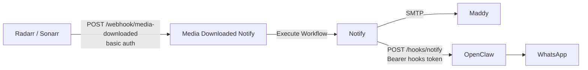

# n8n Seed Workflows

n8n workflow exports for this cluster's notification path, plus the credential records they use.
The n8n to OpenClaw wiring is cluster-specific, so it lives here rather than in the `apps-ai`
module, which stays OpenClaw-agnostic.

Nothing in this directory is applied by Flux. n8n keeps workflows and credentials in its Postgres
database, so they get there by running the n8n CLI against that database (see
[Importing](#importing)).

| File | Purpose |
| ---- | ------- |
| `notify-subworkflow.json` | Shared `Notify` sub-workflow. Takes `subject` and `message`, emails them through Maddy and sends `subject: message` to WhatsApp through OpenClaw |
| `media-downloaded-notify.json` | Radarr/Sonarr webhook (basic auth) that turns a movie or episode import into a one-line message and calls `Notify` |
| `credentials/credentials.json` | Credential records the workflows reference by ID. They carry no secrets. n8n fills in the values at runtime from its credential-overwrite data |



## OpenClaw contract

`Notify` posts `{"source": "n8n", "message": "<text>"}` to
`http://openclaw.openclaw.svc.cluster.local:18789/hooks/notify` with
`Authorization: Bearer <OpenClaw hooks token>`. OpenClaw's `notify` hook mapping decides where the
message goes, so n8n holds no phone numbers or channel names. Any 4xx/5xx fails the `Notify`
execution after three attempts, and the failure shows in n8n's executions list. Radarr and Sonarr
still see `200`, because the webhook answers as soon as it receives the request.

The email branch is set to continue on error, so an SMTP outage does not stop the WhatsApp message.
The execution still reports success in that case, and the email error is only visible inside the
execution's data.

## Prerequisites

These live outside this directory and must hold before the workflows can succeed.

- **Credential-overwrite data reaches n8n**: n8n reads the variable `CREDENTIALS_OVERWRITE_DATA`
  (no `N8N_` prefix). Without it the credential records stay empty and the webhook answers `500`.
- **OpenClaw is allowlisted for SSRF protection**: `openclaw.openclaw.svc.cluster.local` must be in
  `N8N_SSRF_ALLOWED_HOSTNAMES`. Otherwise n8n refuses the request because the Service resolves to a
  private address.
- **OpenClaw serves `/hooks/notify`**: `hooks.path` is `/hooks` and a hooks mapping matches path
  `notify` (in `../../openclaw/openclaw.json`).
- **BWS key `n8n_credentials_overwrite`** holds this JSON. n8n applies each entry to every
  credential of that type, which is why each service here uses a different credential type.

  ```json
  {
    "httpBearerAuth": { "token": "<same value as BWS openclaw_hooks_token>" },
    "httpBasicAuth": { "user": "<arr webhook user>", "password": "<arr webhook password>" },
    "smtp": { "host": "smtp.<domain>", "port": 587, "secure": false, "user": "<n8n_smtp_user>", "password": "<n8n_smtp_password>" }
  }
  ```

  Any credential of these three types created later in the n8n UI receives the same values. Pick a
  different credential type for a new service, or extend this blob deliberately.

## Importing

The CLI runs inside the n8n pod against the live database. Its root filesystem is read-only, so
stage files in `/tmp`. Each CLI call starts a second n8n process inside the same container and its
1 GiB memory limit, so run them one at a time. `notify-subworkflow.json` contains `${domain_name}` placeholders in its email
addresses. Flux would substitute them if it applied the file, but it does not, so replace them while
copying. `fromEmail` must be an address the SMTP account may send as (BWS `n8n_smtp_sender`).

```bash
DOMAIN=<domain_name>
kubectl -n n8n exec deploy/n8n -- mkdir -p /tmp/seed
for f in notify-subworkflow.json media-downloaded-notify.json credentials/credentials.json; do
  sed "s/\${domain_name}/${DOMAIN}/g" "$f" \
    | kubectl -n n8n exec -i deploy/n8n -- sh -c "cat > /tmp/seed/$(basename "$f")"
done
kubectl -n n8n exec deploy/n8n -- n8n import:credentials --input=/tmp/seed/credentials.json
kubectl -n n8n exec deploy/n8n -- n8n import:workflow --input=/tmp/seed/notify-subworkflow.json
kubectl -n n8n exec deploy/n8n -- n8n import:workflow --input=/tmp/seed/media-downloaded-notify.json
kubectl -n n8n exec deploy/n8n -- n8n publish:workflow --id=NotifyWhatsApp01
kubectl -n n8n exec deploy/n8n -- n8n publish:workflow --id=MediaDownloaded1
kubectl -n n8n rollout restart deploy/n8n
```

- **Re-importing**: import upserts by the workflow `id` in each file and overwrites any edits made in
  the UI. It also unpublishes the workflow, so always publish again afterwards.
- **Restart**: the running server only picks up CLI changes to published workflows after a restart.
  For a few seconds after startup, `Media Downloaded Notify` can still call the previously published
  `Notify` version.
- **Fixed IDs**: `media-downloaded-notify.json` calls `Notify` by its ID `NotifyWhatsApp01`. Keep
  both IDs stable.

## Radarr and Sonarr

In each app, add a Webhook connection under Settings, Connect.

| Field | Value |
| ----- | ----- |
| URL | `http://n8n.n8n.svc.cluster.local:5678/webhook/media-downloaded` |
| Method | `POST` |
| Username / Password | the `httpBasicAuth` values from `n8n_credentials_overwrite` |
| Triggers | "On File Import" only |

Every request the workflow accepts sends a WhatsApp message, including the connection's Test button.
Sonarr sends one request per imported file, so a season pack produces one message per episode.
