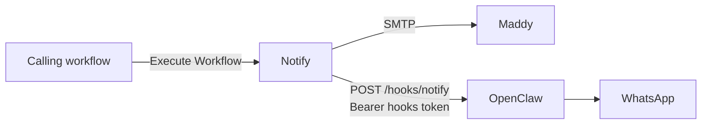
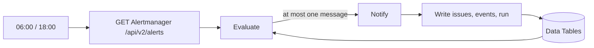
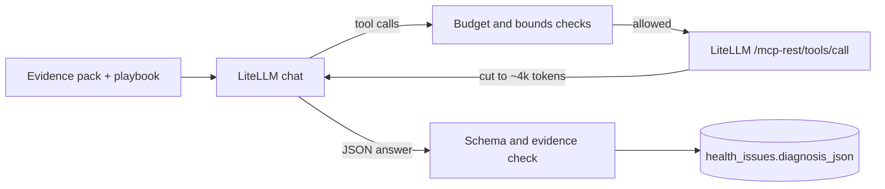

# n8n Seed Workflows

n8n workflow exports for this cluster's notification path, plus the credential records they use.
The n8n to OpenClaw wiring is cluster-specific, so it lives here rather than in the `apps-ai`
module, which stays OpenClaw-agnostic.

Nothing in this directory is applied by Flux. n8n keeps workflows and credentials in its Postgres
database, so they get there by running the n8n CLI against that database (see
[Importing](#importing)).

| File | Purpose |
| ---- | ------- |
| `notify-subworkflow.json` | Shared `Notify` sub-workflow. Takes `subject`, `message` and an optional `source` (default `n8n`), emails the first two through Maddy and sends `subject: message` to WhatsApp through OpenClaw |
| `alertmanager-immediate.json` | Webhook `POST /webhook/alertmanager-immediate` for Alertmanager's immediate route. Checks the `Authorization` header against a Header Auth credential, turns each alert into one line (`resolved_summary` when resolved, `summary` otherwise) and calls `Notify` with `source: alertmanager`. Responds 200 before `Notify` runs |
| `health-triage.json` | Twice-daily cluster health check (see [Health check](#health-check)). Reads Alertmanager, tracks issues in Data Tables and sends at most one message per run through `Notify` |
| `health-last-run.json` | `GET /webhook/health/last-run`, answered only to callers inside the cluster: whether the latest 06:00 or 18:00 `Health Triage` run finished (see [Run liveness](#run-liveness)) |
| `health-pages.json` | `GET /webhook/health/issues` (open and recently resolved issues) and `GET /webhook/health/issue?fp=<fingerprint>` (one issue: state, history, labels, diagnosis). Basic auth, user `health` |
| `health-diagnose.json` | Sub-workflow `Health Diagnose`, called by `Health Triage` for up to two new or changed High issues per run. An LLM investigates through read-only tools under hard budgets and the result is stored on the issue (see [Diagnosis](#diagnosis)) |
| `credentials/credentials.json` | Credential records the workflows reference by ID. They carry no secrets. n8n fills in the values at runtime from its credential-overwrite data |

Quiet hours are defined once, in `Notify`'s `Settings` node (start, end, timezone), and apply to every
message n8n sends. A message arriving inside the window is held in a waiting execution until the window
ends, then sent to both channels.



## OpenClaw contract

`Notify` posts `{"source": "n8n", "message": "<text>"}` to
`http://openclaw.openclaw.svc.cluster.local:18789/hooks/notify` with
`Authorization: Bearer <OpenClaw hooks token>`. OpenClaw's `notify` hook mapping decides where the
message goes, so n8n holds no phone numbers or channel names. Any 4xx/5xx fails the `Notify`
execution after three attempts, and the failure shows in n8n's executions list.

The email branch is set to continue on error, so an SMTP outage does not stop the WhatsApp message.
The execution still reports success in that case, and the email error is only visible inside the
execution's data.

## Health check

`Health Triage` runs at 06:00 and 18:00 America/New_York (the workflow's own timezone setting, so DST
is handled). Each run reads every active alert from Alertmanager, silenced and inhibited ones included,
and decides deterministically what the user hears. No LLM is involved in that decision or in the message.



| Rule | Behaviour |
| ---- | --------- |
| Pipeline check | `Watchdog` must be in the snapshot. If it is missing or Alertmanager cannot be read, the run raises one "alert pipeline blind" issue and leaves every other issue untouched |
| Heartbeats | Every capability in `Settings` > `expected_heartbeats`, and every `CapabilityHeartbeat` seen in the previous run, must be present. A missing one raises an issue at that capability's tier, and issues of that capability cannot resolve while it is missing |
| Identity | An issue's fingerprint hashes the cluster, alert name, capability and the alert's labels minus per-pod and per-scrape labels (`prometheus`, `alertgroup`, `pod`, `instance`, `job`, ...). A missing `k8s_cluster` counts as `homelab`, so the metrics-store migration (which adds that label and drops `prometheus`) opens no new issues |
| Tier | The alert's `tier` label, else the alert-name and namespace maps in `Settings`, else `L` |
| States | new, still, worsened (higher severity), changed (reason labels), accepted (every alert silenced or inhibited), resolved (absent from two consecutive trustworthy runs), reopened |
| Dependencies | An open issue whose capability sits downstream of another open issue's capability (`Settings` > `dependencies`) is attached to it and not announced on its own |
| Who hears what | High tiers (H1-H3) always; Medium only while no High is open; Low never. Each issue is announced once per state, so the same snapshot twice sends nothing |

The message names the problem, its impact, its blast radius and a link to the issue's page; nothing
else. `Notify` runs before the run's state is written, so a failed send changes nothing and the next run
sends the same message again. A run that fails part-way leaves its `health_runs` row without
`finished_at`.

The workflow creates its Data Tables on first run if they do not exist: `health_issues` (one row per
fingerprint), `health_events` (state transitions) and `health_runs` (one row per run). Re-importing the
workflow leaves them intact. Deleting `health_issues` re-announces every open High issue once.

Settings live in the workflow's `Settings` node: Alertmanager URL, page URL, capability catalog with
tiers and impact text, expected heartbeats, the dependency graph and the tier maps. nas heartbeats belong
in `expected_heartbeats` once nas rules are evaluated centrally.

### Diagnosis

After a run has sent its message and written its state, `Health Triage` calls `Health Diagnose` for up
to two independent High issues whose current signature has not been diagnosed. The LLM explains why;
it never decides whether something is wrong, how urgent it is, or who is told. One attempt is made
per issue signature, whatever its outcome, so a recurring issue with an unchanged signature keeps its
old diagnosis.



| Limit | Value | Enforced by |
| ----- | ----- | ----------- |
| Tool calls | 8 | `Step` node; the model is then asked to answer without tools |
| Input tokens, cumulative | 120k | `Step` node, from each response's `usage` |
| Wall time | 5 minutes | workflow execution timeout, plus a check in `Step` |
| Tool result size | 16,000 characters (about 4k tokens) | `Tool Results` node |
| Unbounded calls | refused | lists need a namespace and a selector; Loki queries need an exact-match stream label |
| Spend | 10 USD per 30 days | the `health-triage` LiteLLM key's budget |

- Tools are seven wrappers (`prometheus_query`, `prometheus_range`, `loki_query`, `k8s_get`, `k8s_list`,
  `k8s_events`, `pod_logs`) that map onto the Grafana and Kubernetes MCP servers through LiteLLM. The
  `health-triage` key allows only those MCP tools.
- An evidence item counts as observed only if it cites the `call_id` of a call that succeeded in this
  session and its excerpt appears in that call's result. Anything else becomes `inferred`, and a
  `confirmed` root cause with no observed evidence becomes `likely`. A diagnosis that ends on a budget
  is stored as `inconclusive` with confidence `unknown`.
- The loop is built from plain nodes rather than n8n's AI Agent node because the Agent node can cap
  iterations but cannot enforce a cumulative token budget or expose each tool call for the evidence
  check.
- Playbooks per capability are in the workflow's `Playbooks` node. Model, gateway URL and data source
  UIDs are in its `Settings` node. The model and its fallbacks are openclaw's, kept equal by hand.

### Issue pages

`Health Pages` renders the Data Tables as HTML at `https://n8n.<domain>/webhook/health/issues` and
`.../health/issue?fp=<fingerprint>`, the links in the triage messages. The n8n Ingress has no SSO, so
both webhooks use n8n's basic auth with the `Health Pages Auth` credential: user `health`, password
from BWS `n8n_health_pages_password`. Every stored value is HTML-escaped and only `http(s)` runbook links
are rendered as links. n8n serves webhook HTML with a `Content-Security-Policy: sandbox` header; the
pages use no scripts, so that does not affect them. The fingerprint is a query parameter because n8n
puts the webhook ID into the URL of any webhook path with a `:parameter`.

### Run liveness

`Health Last Run` serves `GET http://n8n.n8n.svc.cluster.local:5678/webhook/health/last-run` for a checker
outside n8n (OpenClaw), so a triage run that never started or never finished is still reported.

```json
{"ok": false, "last_run": {"run_id": "run-123", "started_at": "...", "finished_at": null, "status": "running"},
 "expected_by": "2026-11-12T11:20:00.000Z", "message": "Health check started at 06:00 America/New_York but did not finish: ..."}
```

- The run in question is the latest 06:00 or 18:00 slot whose deadline, 20 minutes after the slot, has
  passed. `ok` is true only if a run recorded for that slot has `finished_at` before the deadline.
  Otherwise `message` says whether the run is missing, unfinished or late, ready to forward as is.
- The slots are written in the workflow's `Compute` node as well as in `Health Triage`'s trigger and
  `Run Context` node. Change all three together.
- **In-cluster only, no auth.** The n8n Ingress routes every `/webhook/*` path, so the workflow itself
  rejects anything that did not arrive on the Service name: it answers 404 unless the `Host` header is
  `n8n.n8n.svc.cluster.local` and no `X-Forwarded-For`, `X-Forwarded-Host` or `X-Real-Ip` header is
  present. Traefik forwards the public host name and adds `X-Forwarded-For`, so a request through the
  Ingress never matches. Callers must use the Service DNS name, not a Pod or Service IP.

## Prerequisites

These live outside this directory and must hold before the workflows can succeed.

- **Credential-overwrite data reaches n8n**: `../externalsecret-n8n-workflow-secrets.yaml` builds
  the `CREDENTIALS_OVERWRITE_DATA` JSON into the `n8n-workflow-secrets` Secret, which the apps-ai
  n8n Deployment takes as an optional `envFrom`. n8n reads that name without the `N8N_` prefix.
  Without it the credential records stay empty and `Notify` fails. It reuses BWS
  `openclaw_hooks_token`, `n8n_smtp_user`, `n8n_smtp_password`, `n8n_health_pages_password` and
  `apikey_litellm_healthtriage` (created by Terraform with the `health-triage` LiteLLM key). Reloader watches the Secret, so
  a changed key rolls n8n.
- **OpenClaw is allowlisted for SSRF protection**: `openclaw.openclaw.svc.cluster.local` must be in
  `N8N_SSRF_ALLOWED_HOSTNAMES`. Otherwise n8n refuses the request because the Service resolves to a
  private address.
- **Alertmanager is allowlisted for SSRF protection**: `Health Triage` reads
  `kube-prometheus-stack-alertmanager.monitoring.svc.cluster.local`, which the `apps-ai` Kustomization adds
  to `N8N_SSRF_ALLOWED_HOSTNAMES` (`../../../../kustomizations/apps-ai.yaml`). Without it every run
  reports "alert pipeline blind".
- **OpenClaw serves `/hooks/notify`**: `hooks.path` is `/hooks` and a hooks mapping matches path
  `notify` (in `../../openclaw/openclaw.json`).

n8n applies each entry of the overwrite JSON to every credential of that type, which is why each
service here uses a different credential type (`httpBearerAuth` for OpenClaw, `smtp` for Maddy,
`httpHeaderAuth` for the Alertmanager webhook, `httpBasicAuth` for the health pages, `openAiApi` for LiteLLM). Any credential of these types created later in the
n8n UI receives the same values. Pick a different credential type for a new service, or extend the
ExternalSecret's template deliberately.

## Importing

The CLI runs inside the n8n pod against the live database. Its root filesystem is read-only, so
stage files in `/tmp`. Each CLI call starts a second n8n process inside the same container and its
1 GiB memory limit, so run them one at a time. `notify-subworkflow.json` (email addresses) and `health-triage.json` (page links)
contain `${domain_name}` placeholders. Flux would substitute them if it applied the file, but it does not, so replace them while
copying. `fromEmail` must be an address the SMTP account may send as (BWS `n8n_smtp_sender`).

```bash
DOMAIN=<domain_name>
kubectl -n n8n exec deploy/n8n -- mkdir -p /tmp/seed
for f in notify-subworkflow.json alertmanager-immediate.json health-triage.json health-last-run.json health-pages.json health-diagnose.json credentials/credentials.json; do
  sed "s/\${domain_name}/${DOMAIN}/g" "$f" \
    | kubectl -n n8n exec -i deploy/n8n -- sh -c "cat > /tmp/seed/$(basename "$f")"
done
kubectl -n n8n exec deploy/n8n -- n8n import:credentials --input=/tmp/seed/credentials.json
kubectl -n n8n exec deploy/n8n -- n8n import:workflow --input=/tmp/seed/notify-subworkflow.json
kubectl -n n8n exec deploy/n8n -- n8n import:workflow --input=/tmp/seed/alertmanager-immediate.json
kubectl -n n8n exec deploy/n8n -- n8n publish:workflow --id=NotifyWhatsApp01
kubectl -n n8n exec deploy/n8n -- n8n import:workflow --input=/tmp/seed/health-triage.json
kubectl -n n8n exec deploy/n8n -- n8n import:workflow --input=/tmp/seed/health-last-run.json
kubectl -n n8n exec deploy/n8n -- n8n import:workflow --input=/tmp/seed/health-pages.json
kubectl -n n8n exec deploy/n8n -- n8n import:workflow --input=/tmp/seed/health-diagnose.json
kubectl -n n8n exec deploy/n8n -- n8n publish:workflow --id=AlertmanagerImm01
kubectl -n n8n exec deploy/n8n -- n8n publish:workflow --id=HealthTriage0001
kubectl -n n8n exec deploy/n8n -- n8n publish:workflow --id=HealthLastRun001
kubectl -n n8n exec deploy/n8n -- n8n publish:workflow --id=HealthPages00001
kubectl -n n8n exec deploy/n8n -- n8n publish:workflow --id=HealthDiagnose01
kubectl -n n8n rollout restart deploy/n8n
```

- **Re-importing**: import upserts by the workflow `id` in each file and overwrites any edits made in
  the UI. It also unpublishes the workflow, so always publish again afterwards.
- **Restart**: the running server only picks up CLI changes to published workflows after a restart.
  For a few seconds after startup, a caller can still reach the previously published `Notify`
  version.
- **Fixed ID**: callers reach `Notify` by its ID `NotifyWhatsApp01`, so keep it stable.
- **Sandbox runs**: replace the Schedule Trigger with a Webhook trigger of the same node name to fire
  runs on demand; nothing else in the workflow refers to the trigger.
